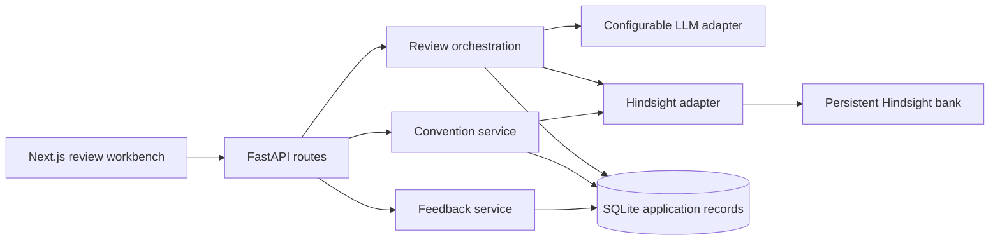

# ReviewMind

An AI code reviewer that brings relevant team decisions into the next review using Hindsight memory.

**Current version:** review studio with a review-aware chat copilot, browser speech input, Memory Lab comparison, evidence citations, review exports, and persistent local conversations. Next.js UI, FastAPI API, configurable LLM adapter, structured validation, SQLite records, and real Hindsight retain/recall. Live Gemini analysis and persistent Hindsight learning passed the configured acceptance test; see the live UI test report below for results and remaining verification limits.

Use `start-backend.ps1` and `start-frontend.ps1` from the project root in separate terminals. Both scripts resolve their working directory relative to themselves. Pass `-Production` to the frontend script after `npm run build`.

## Run locally (PowerShell)

Prerequisites: Python 3.12+, Node.js 22.18+ (24 recommended; used for the TypeScript speech tests) with npm, a model API supporting the Chat Completions JSON response contract, and a Hindsight service for memory-enabled reviews. The development servers bind to 127.0.0.1. Do not expose this prototype publicly without access protection and deployment hardening.

From this `ReviewMind` directory:

```powershell
Copy-Item .env.example backend/.env
Copy-Item frontend/.env.example frontend/.env.local
python -m venv backend/.venv
backend/.venv/Scripts/python.exe -m pip install -r backend/requirements-dev.txt
cd frontend
npm ci
cd ..
```

Set values in `backend/.env` using your editor. Never paste keys in chat or commit `.env` files. This implementation deliberately has no default model: select a model available to your provider and verify its structured-output support and pricing. The application makes real, potentially billable calls when configured.

Start the backend in one terminal:

```powershell
cd backend
.venv/Scripts/python.exe -m uvicorn app.main:create_app --factory --host 127.0.0.1 --port 8000
```

Start the frontend in another:

```powershell
cd frontend
npm run dev
```

Open http://127.0.0.1:3000. The API health endpoint is http://127.0.0.1:8000/health and interactive API docs are http://127.0.0.1:8000/docs. `/api/status` checks configuration presence, not live connectivity. No secrets are returned. When `API_TOKEN` is configured, enter that application token in the UI Settings panel; provider keys stay on the server.

For a production build locally: `npm run build` then `npm run start` from `frontend`.

## Configuration

See [API options and integration priorities](docs/api-options.md) for researched model providers, OSV vulnerability checks, GitHub PR import, and setup verification steps.

| Variable | Meaning |
| --- | --- |
| `LLM_BASE_URL` | Trusted OpenAI-compatible API base ending in `/v1`; calls `/chat/completions` |
| `LLM_API_KEY` | Server-only provider credential |
| `LLM_MODEL` | Explicit model identifier available to your account |
| `LLM_RESPONSE_FORMAT` | `json_object` (default) or `json_schema` if strict schemas are supported |
| `REQUEST_TIMEOUT_SECONDS` | Per-service timeout, default 60; maximum 180 |
| `DATABASE_PATH` | SQLite path, default `data/reviewmind.db` relative to the backend working directory |
| `ALLOWED_ORIGINS` | JSON list of allowed frontend origins |
| `API_TOKEN` | Optional shared application token for a private demo; not a multi-user auth system |
| `HINDSIGHT_BASE_URL` | Your actual Hindsight API URL; blank means unavailable |
| `HINDSIGHT_API_KEY` | Hindsight service credential if required |
| `HINDSIGHT_BANK_ID` | Existing, authorized bank provisioned in your Hindsight service |
| `PROJECT_ID` | Server-owned project scope, used with strict recall tags |
| `NEXT_PUBLIC_API_BASE_URL` | Public frontend setting in `frontend/.env.local`; never put keys here |

Configure a trusted provider endpoint: source code is sent there for analysis. Hindsight receives code context for relevant recall and explicit convention text for retention. Review inputs and outputs are stored unencrypted in the local SQLite database. Use synthetic/public code for the initial demo. Submitted code is never executed. Logs do not deliberately record source or credentials.

Keep one database per configured project. If you change `PROJECT_ID` or switch workspaces, use a different `DATABASE_PATH`; application review/history rows are single-workspace records in this milestone.

## What works in this slice

- Pasted code and text file uploads; unified diff parsing with findings constrained to added lines.
- Limits of 100 KB UTF-8 and 2,000 lines per submission; 120 KB transport limit. No binary execution or archive extraction.
- Validated finding categories, severities, uncertainty, ranges, and retrieved-memory citations. Exact normalized duplicate titles in overlapping ranges are merged; semantic paraphrase deduplication is not guaranteed.
- Real HTTP LLM integration with JSON validation and one bounded retry for malformed output. Network/provider errors return sanitized messages.
- Two concurrent review slots; bounded HTTP timeouts. No paid fallback provider or mock success path.
- Real async Hindsight `aretain` and `arecall` calls, source document IDs, project tags, `all_strict` recall, and explicit retention success checks.
- Memory-enabled failures stop the review. They never silently become baseline results.
- SQLite review history persists across API restarts; feedback is recorded separately and is not automatically promoted into memory.
- Explicit conventions have `pending`, `retained`, or `failed` local audit states. These rows are not a substitute for Hindsight memory.
- Memory explanations include review-level influence, including a lesson that prevented an unnecessary finding. Such explanations are model-reported citations, not proof of causality.

## Studio features

- **Copilot:** discuss a completed review, fixes, tradeoffs, or test ideas. A new chat attaches the currently completed review; unsaved editor content is not sent. Conversation history is server-owned and stored locally in SQLite. Recent conversations resume after restart. The model receives the latest six exchanges; threads allow 50 exchanges before starting a new chat.
- **Memory in chat:** opt into scoped Hindsight recall for each message. The answer exposes only validated, cited evidence. A missing memory service produces an error, with no silent fallback. “Turn into a lesson” copies a user message to an editable teaching form; it does not retain anything until you submit the form.
- **Speech input:** click Dictate, speak, stop, edit, then Send. English (India), Hindi, and English (US) are selectable. Interim speech stays separate from finalized text. Microphone capture ends when leaving the chat. Speech recognition depends on browser support and permission; some browsers send audio to their recognition service. No additional app API key is needed. See [MDN SpeechRecognition](https://developer.mozilla.org/en-US/docs/Web/API/SpeechRecognition). Actual microphone transcription has not been verified in this environment.
- **Memory Lab:** review the current source twice, without then with memory. Both completed reviews are saved in history. Compare severity, findings, recalled lessons, and model-reported influence. This spends two LLM calls plus recall. Differences may include model variability; this is an inspection tool, not proof of causality or a replacement for the live acceptance test. A partial failure preserves any completed first review.
- **Triage and handoff:** filter by severity; export the full current review as Markdown or JSON; open it in Copilot. JSON includes the submitted source. Ctrl/Cmd+Enter runs a review from the source editor. Reduced-motion preferences are respected.

## Visual states

The real app starts empty. “Load example code” loads input only and still requires a real provider call.

`http://127.0.0.1:3000/preview` is a separately labeled visual fixture page for idle, loading, success, empty, and error layouts. It performs no AI/Hindsight calls. Its fixture findings are never returned by the backend and must not be used as evidence of the learning-cycle acceptance test.

## Checks

See the [live UI test report](docs/ui-test-report.md) for the 2026-10-26 walkthrough, fixes, and remaining microphone/download verification limits.

```powershell
cd backend
.venv/Scripts/python.exe -m pytest -q
cd ../frontend
npm run typecheck
npm test
npm run format:check
npm run build
```

Unit/API tests use explicitly injected test doubles or HTTP mock transports. They test validation, path/line handling, duplicates, provider errors, strict memory parameters, failure states, access control, and local database persistence. They do not prove real model quality or Hindsight persistence. See `docs/milestone-1.md` for the actual executed results.

## Real learning-cycle acceptance

After configuring both real services, run from `backend`:

```powershell
$env:RUN_LIVE_TESTS = '1'
.venv/Scripts/python.exe -m pytest tests/test_learning_live.py -v
Remove-Item Env:RUN_LIVE_TESTS
```

This opt-in test makes potentially billable provider/Hindsight calls. It creates a unique disposable Hindsight test bank and deletes only that bank afterward. The configured service credential needs permission to create/delete test banks. It never clears your configured application bank.

The test runs a real baseline, teaches the shared-client retry convention, recreates service objects, recalls actual stored memory, reviews another shared-client example, checks the review explanation, verifies that a direct network call can still get a retry finding, and checks isolation from an unrelated project. The generated reviews are stored in a temporary SQLite database. No expected finding is injected into model output. Model variation can cause a real assertion failure; investigate the generated behavior instead of weakening or faking the result. Baseline analysis might already make the right recommendation; memory does not guarantee an improvement on every example.

Manual UI walkthrough:

1. In Team memory, teach: “The shared HTTP client `shared_http.client` already handles retries. Do not add a second retry loop around its calls.”
2. Scope it: “Only `shared_http.client` calls in this project. Direct `requests.get` calls are not covered.”
3. Confirm retention, then review code using the shared client with memory enabled.
4. Inspect “How memory influenced this review” and the recalled lesson IDs.
5. Review a direct idempotent network call subject to transient upstream failures. The shared-client exception must not suppress an otherwise justified recommendation.

## Boundaries and next milestone

Not yet complete: quantitative memory evaluation, memory correction/deletion UI, robust feedback-to-lesson approval/retry workflow, GitHub import, multi-user authentication, PostgreSQL deployment, and deployment verification. SQLite initialization adds the conversations table without changing existing tables; introduce versioned migrations before modifying persisted columns. Feedback writes persist and saved selections and reasons reload when opening a review from history.

For a new installation, configure your services and run the shared-client acceptance cycle. Next steps include quantitative memory evaluation and deployment hardening.

## Architecture and SDK references



Official sources checked before implementation: [Python SDK](https://hindsight.vectorize.io/sdks/python), [recall tag semantics](https://hindsight.vectorize.io/developer/api/recall), [document provenance](https://hindsight.vectorize.io/developer/api/documents). The installed `hindsight-client==1.1.0` method signatures were inspected directly. SDK compatibility does not establish a live service connection.
