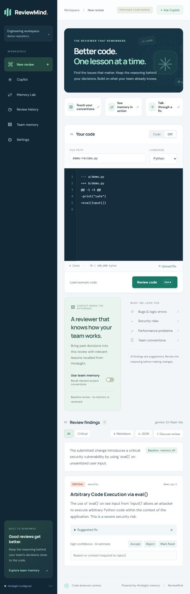

# Live UI checks — 2026-10-26

Tested the production UI at http://127.0.0.1:3000 against FastAPI, Gemini `gemini-3.1-flash-lite`, and Hindsight Cloud with synthetic inputs. Submitted code was not executed.

| Check | Result | Evidence |
| --- | --- | --- |
| Empty editor | Pass | Review button disabled. |
| Example code / baseline review | Pass | Real model returned missing-timeout and HTTP-error-handling findings. |
| Fix details / severity filter | Pass | Expanded suggested fix and selected Medium filter. |
| Accept / reject with reason / mark fixed | Pass | Feedback saved. |
| Feedback restored from history | Pass after fix | After rebuilding and restarting, saved selections and rejection reason were restored. |
| Teach convention | Pass | Hindsight confirmed retention; source appeared as RETAINED, separate from an older FAILED audit row. |
| Memory-enabled review | Pass | Shared-client example returned zero findings, five recalled memories, and a retry-policy explanation. |
| Copilot with memory | Pass | Real review-aware answer cited three project lessons. |
| History / conversation persistence | Pass | Reviews, feedback, and conversation resumed after server restart and page reload. |
| Turn message into lesson | Pass | Opened editable teaching draft without automatically retaining it. |
| Memory Lab | Pass | Both real reviews completed and were saved; baseline recalled zero memories, contextual run recalled five. Both returned zero findings, so this run does not demonstrate fewer false positives. |
| File upload | Pass | Uploaded docs/demo-review.py; source and path updated. |
| Malformed diff | Pass | Actionable error; no fabricated result. |
| Valid diff | Pass after prompt clarification | Initial model response failed file/line validation. After clarification, the same diff returned a critical eval(input()) finding at demo.py:1. Model variability remains possible; validation remains enforced. |
| Dictation controls | Pass | Selected Hindi, started Listening, stopped, returned to editable input. |
| Actual spoken transcription | Unverified | No controlled spoken sample provided. |
| Markdown / JSON file delivery | Unverified | In-app browser canceled both downloads; Chrome download-event check stalled. Passing Markdown generation tests do not prove file delivery. |

## Changes

### Copilot intent correction

After a user reported that a greeting triggered an unsolicited review, changed the chat instructions so review context is optional background and the latest user message determines the response. Greetings and thanks should receive brief conversational replies; code advice is conditional on the question. The latest question is now also sent as a separate final user message rather than only inside the JSON context payload.

Validation: 20 chat/provider tests passed. Real Gemini checks with an attached saved review and prior code discussion returned a greeting for `hello`, an acknowledgment for `thanks`, and relevant test suggestions for an explicit code question. A greeting without an attached review also worked. No canned greeting response was added to application code.

Added a read-only saved-feedback API and storage query; restore selections and reasons when reopening history. Clear reasons when changing inputs or starting another review. Added persistence/missing-review assertions to the existing regression test. Clarified that the model must cite parsed diff paths and new-file line numbers from valid_lines.

## Automated checks

- Backend: 65 passed, 1 opt-in live test skipped in this regression run. The real persistent-learning acceptance test passed separately earlier in this chat.
- Frontend: 4 passed; TypeScript and production build passed after the feedback fix.
- Provider tests after prompt update: 9 passed.
- Pytest used workspace-local temporary directories because the default OS temp directory was inaccessible.

The UI walkthrough retained one intended shared-client convention and saved demo reviews, feedback, and a conversation. The draft copied from Copilot was not retained. Credentials are excluded from this report.

